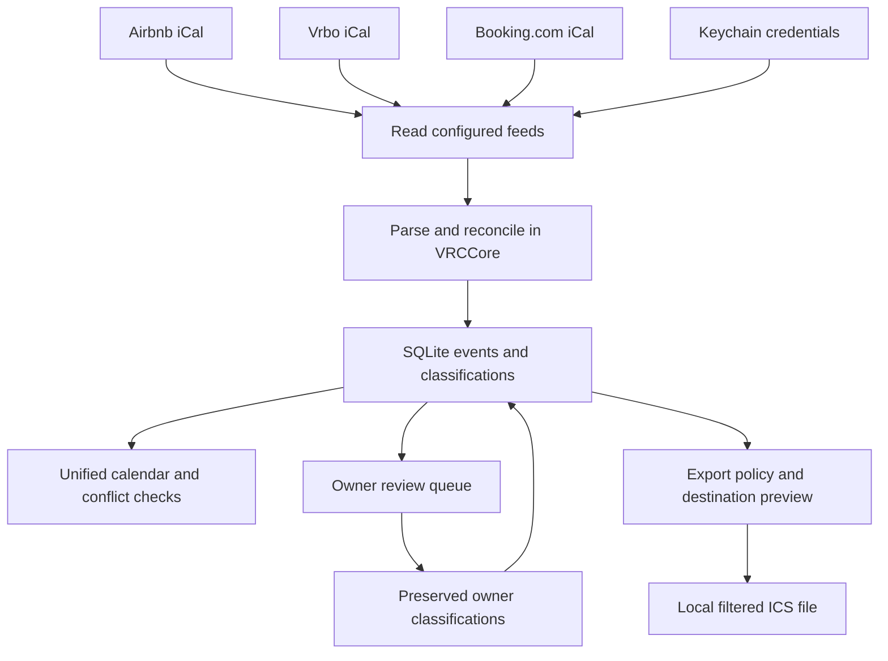
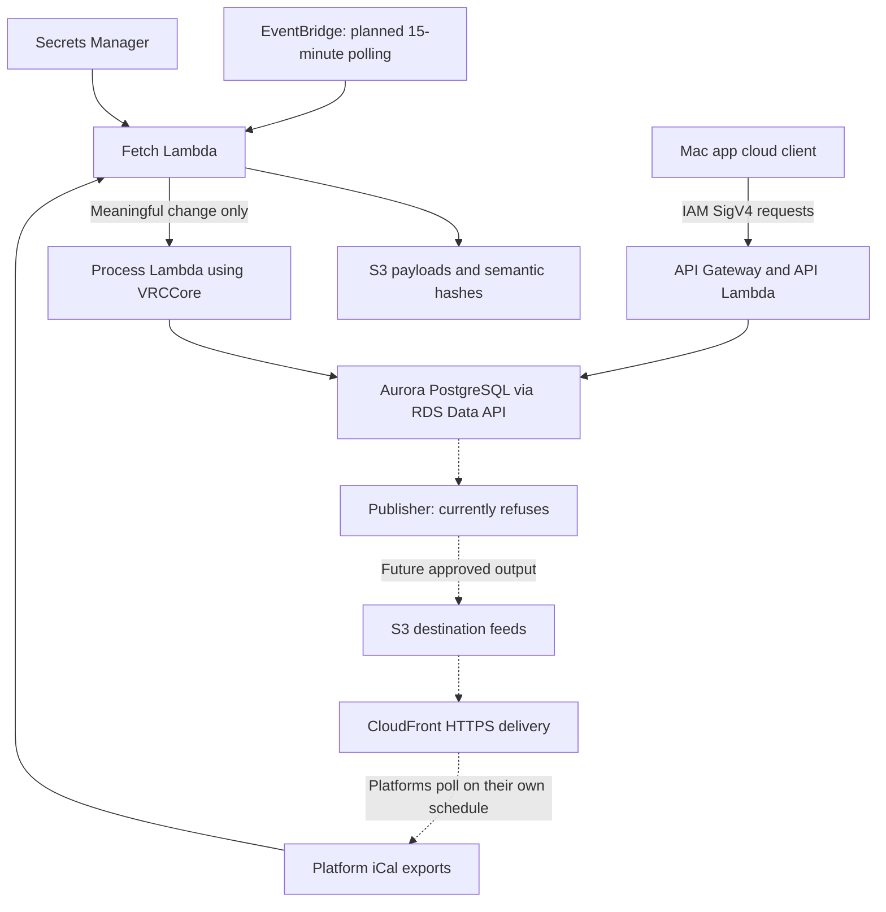

# How Vacation Rental Calendar works

**Work in progress:** implementation, integration and deployment remain in progress. Keep this guide and its diagrams aligned with verified changes using the [documentation maintenance guidance](README.md#keeping-documentation-current).

Documentation baseline: November 9, 2026. This guide describes the checked-out source and separates the working local application from the intended cloud service. Deployment status comes from [HANDOFF.md](../HANDOFF.md); it was not independently checked against AWS for this documentation change.

## Purpose

Vacation Rental Calendar combines Airbnb, Vrbo and Booking.com calendars in a native Mac application. It helps the owner identify real reservations, investigate overlapping bookings, and decide which dates should be unavailable on other platforms.

The central rule is simple: **a platform saying “unavailable” does not prove a guest booked the property.** Airbnb cancellation penalties and booking-window restrictions must not make sellable nights disappear from Vrbo or Booking.com.

## What exists today

| Capability | Current state |
|---|---|
| SwiftUI Mac application | Implemented; local SQLite storage and Keychain credentials |
| Calendar imports, classification, review and conflicts | Implemented in shared `VRCCore` |
| Filtered local `.ics` export | Implemented; creating a file does not change a platform |
| Owner availability decisions and audit | Implemented; approval is distinct from publication |
| Cloud client, Lambda handlers and Terraform | Source exists; backend not deployed per handoff |
| Always-on cloud import | Intended operation after deployment and integration verification |
| Public destination feeds | Planned delivery through S3 and CloudFront; not live |
| Outbound publication | Hard-coded off; publisher entry point also refuses live publication |
| Website booking integration | Proposal; do not treat it as an active source |

The Mac remains the user interface. A web dashboard is outside the current design.

## Local application flow

Only configured, connected feeds are read. A supported platform is not necessarily connected on this installation. Imports run on demand or on the configured timer while the application runs; the local application cannot import while the Mac is asleep.

### 1. Import observations

The app fetches a platform’s iCal export, parses date ranges and reconciles observations with existing records. Stable event keys let later imports update an event without duplicating it. Manual classifications survive subsequent imports.

A failed, empty or truncated feed must not be interpreted as proof that reservations disappeared. Confirmed reservations must not be silently reopened or shortened by an import.

### 2. Separate reservations from restrictions

The classifier uses positive evidence such as booking-specific content. Ambiguous events go to owner review. Missing booking details are not evidence that a block is safe to share.

| Classification | Meaning | Local export eligibility |
|---|---|---|
| Confirmed reservation | A real stay, supported by evidence or owner confirmation | Eligible after policy checks |
| Owner block | Dates the owner wants held | Manual classification and export approval required |
| Maintenance block | Property unavailable for maintenance | Manual classification and export approval required |
| Cancellation block | Platform penalty after cancellation | Never |
| Platform restriction | Platform-specific booking window or restriction | Never |
| Unknown unavailable | Insufficient evidence | Never while unknown |

Pending review, manual suppression, cancelled source events, tombstones and events originating from the destination platform are also excluded by `ExportPolicy`.

**Eligibility is not publication.** A confirmed reservation can qualify for a local export without authorizing a live change. Destination-feed generation has its own publication scope; its default is `approvedManualBlocksOnly`. Owner approval is required for live additions and removals.

### 3. Review and investigate

The owner sees month, week and list calendars, reservations, availability, review and settings. Event details explain classification and source evidence. Overlapping confirmed reservations on the same property raise conflicts; a checkout and check-in on the same day are a normal turnover.

Hiding platform restrictions in the calendar only changes the view. It does not change export rules or conflict analysis.

### 4. Preview availability changes

The owner chooses dates and destinations, previews the effect, and approves or cancels a decision. Source observations, classifications and destination decisions are separate records: “Vrbo sent this event” and “the owner wants Airbnb blocked” are different facts.

Dates use `[check-in, check-out)`: a December 10–17 stay occupies seven nights and leaves December 17 available for the next check-in. All-day date arithmetic uses UTC midnight.

### 5. Generate and eventually verify

A local `.ics` file is an inspection artifact. Future live delivery must pass approval, export-policy checks, publication safety checks and the outbound gate. Uploading bytes, serving them over HTTPS and a booking platform actually consuming them are separate stages.

Remote synchronization needs evidence from the destination’s own export. A successful upload alone never means the booking platform updated its calendar.

## Intended cloud operation

**This diagram is the target flow, not a deployed system.** Backend integration gaps listed below must be closed before enabling schedules.

Solid arrows show intended read/import and control paths. Dotted arrows mark the unavailable publication path. None of these cloud paths is live according to the handoff.

The fetcher compares normalized event content with stored semantic hashes before invoking the processor. This is intended to avoid waking Aurora for unchanged calendars. The fetcher has no database credential or outbound publication token.

Aurora becomes the central store after a controlled migration. The Mac cloud client signs API requests with AWS Signature Version 4. The cloud uses the same Swift business library as the Mac; PostgreSQL persistence uses the RDS Data API rather than direct database connections from Lambda.

A separate sweeper is intended to release expired provisional holds, without changing confirmed reservations. Holds are not a reason to publish permanent unavailability.

## Work still required

- Repair the local credential access described in the handoff and verify real feed-change behavior.
- Produce deployable Static Linux SDK packages and complete the deployment checks.
- Resolve handler/schema compatibility: `ProcessHandler` still refers to `source_events` and `import_runs`, and `SweeperHandler` to `holds`, while the current generated schema defines `events` and `sync_runs` and no `holds` table. Handler existence is not evidence that these paths work against the current schema.
- Configure and verify Mac UI use of the cloud client; the present `AppState` uses local repositories.
- Review infrastructure, deploy with schedules disabled, and reconcile migrated data before enabling imports.
- Implement the publisher’s live decision loading and obtain explicit authorization before changing the outbound gate.

These are implementation/deployment prerequisites, not steps performed by this documentation change. Existing website and Google Calendar systems remain outside the active integration. The website proposal is read-only and does not authorize writes to its DynamoDB tables.

## Limits

iCal synchronization is eventually consistent: platforms poll feeds on their own schedules. Even a running cloud importer cannot promise immediate double-booking protection. Feed ambiguity still needs human review. Repeating `RRULE` events are not expanded into stays.

## Read next

- [First-run walkthrough](GETTING-STARTED.md)
- [Component and data reference](COMPONENTS.md)
- [Documentation index](README.md)
- [Operational handoff](../HANDOFF.md)
